# oh-my-claudeagent

**Claude Code, with receipts.**

[](https://github.com/UtsavBalar1231/oh-my-claudeagent/actions/workflows/ci.yml)

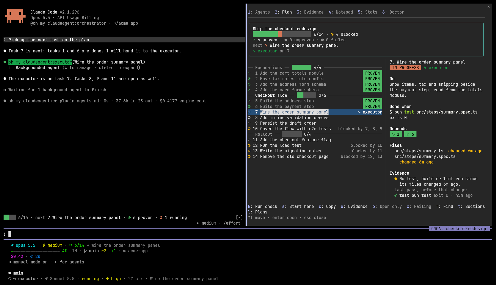

oh-my-claudeagent (OMCA) coordinates specialist agents, plans and verification evidence in
Claude Code and OpenCode V2. Both adapters share state formats, safety checks and durable
operations. Claude Code also gates completion on logged verification; OpenCode labels the
evidence without a Stop veto. The blog post
[Claude Code, with receipts](https://utsavbalar.in/blog/oh-my-claudeagent) describes the original
workflow.

## Requirements

- Claude Code 2.1.300 or later. Tested with 2.1.301.
- bun 1.4.2 or later, on the `PATH` Claude Code starts with. The `omca` server, its hooks and
  the status line run on bun.
- `ast-grep` (or `sg`), optional. Only the structural code search tools need it.

CI runs on Linux, macOS and Windows.

## Install

```bash
claude plugin install oh-my-claudeagent --marketplace UtsavBalar1231/oh-my-claudeagent
```

The command adds the `omca` marketplace when it is not added yet, then installs from it. The
marketplace installs from the `plugin` branch, a packaged tree with no `package.json` or
lockfile, so installing fetches no npm dependencies.

Inside a session, the same steps are `/plugin marketplace add UtsavBalar1231/oh-my-claudeagent`
and `/plugin install oh-my-claudeagent@omca`. Then run `/oh-my-claudeagent:omca-setup`, which
checks the requirements above and offers to point your status line at OMCA's renderer.

### OpenCode V2

The OpenCode adapter requires OpenCode 2.0.29 or later in the 2.0 release line.
It adds a selectable `omca` coordinator, native specialist tools, and a terminal
panel opened with `/omca`. Build and Plan remain available. See
[OpenCode setup](docs/usage.md#use-it-from-opencode) for installation and limits.

## Your first plan

1. Run `/oh-my-claudeagent:plan add rate limiting to the login endpoint`. The planner asks
   what it needs to know, has the plan reviewed, and writes it to your plans directory.
2. Run `/oh-my-claudeagent:start-work`. The session hands each task to an executor, records a
   verification after each one, and checks the plan's boxes as tasks finish.
3. Open `/omca` to watch the agents, the plan, the evidence and the notepad while it runs.

When the session tries to stop with tasks unchecked, or with every task checked and no final
verification logged, OMCA sends it back to work with the reason.

## Try it

- `/oh-my-claudeagent:plan add rate limiting to the login endpoint`
- `Find where the session token is refreshed and explain the flow`
- `/omca doctor`

## What you see

OMCA shows its work in Claude Code's own transcript. The line that closes each turn carries its
tokens, its cost and a receipt for the verification it ran. An agent starts and finishes in its
own color, the finish with its duration, tool calls, tokens and the first line of its reply. A
test, build or lint run gets its result under the shell commands that ran it, and a screenshot
Claude reads shows as a picture where the terminal draws them.

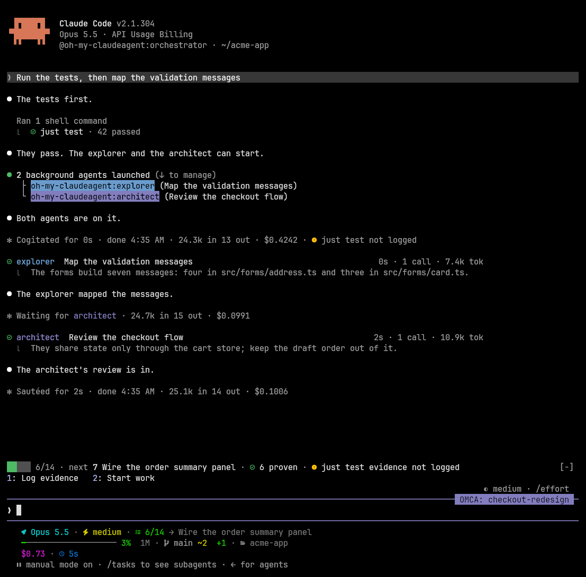

The band above the prompt shows the bound plan's progress, the next open task, how many tasks are
proven, unproven and failed, and a verification whose evidence was not logged. The numbered
buttons fill the prompt with the next step.

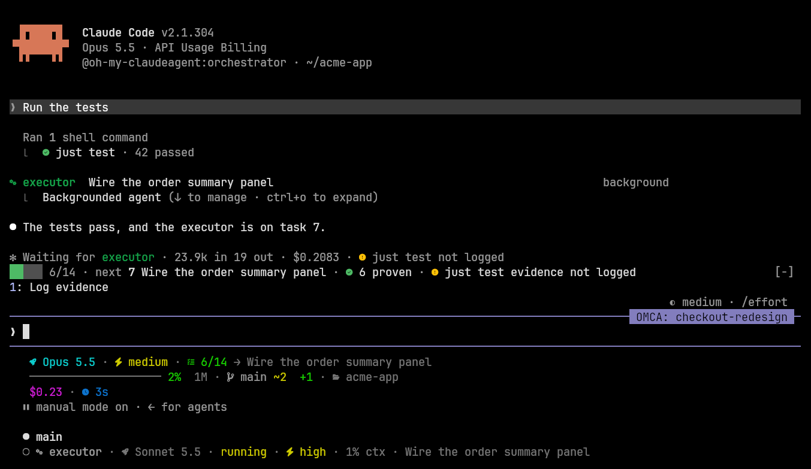

`/omca plan` opens the plan board: the tasks grouped by milestone, each with its state, its proof
and the agent working on it. A wide pane shows the focused task's detail beside the list.


The Evidence tab is the proof ledger: a verdict on the plan's final verification, then every
logged run grouped by day.

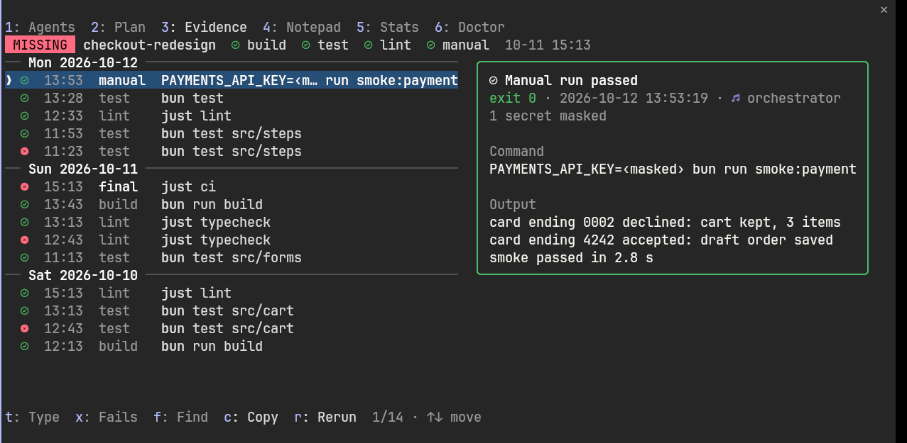

The Agents tab gives each subagent a lane led by its mascot, with its task, current tool call,
model, effort and tokens. The last wave's finished agents keep their lanes with their results,
earlier ones shrink to a line, and in a short pane each lane keeps to two rows.

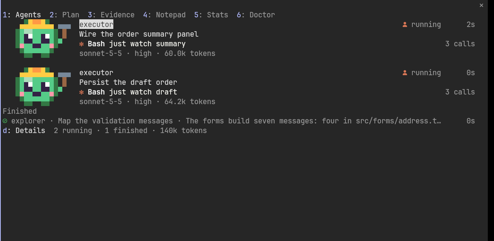

When the pane has room, each lane gets four rows of its own. The agent page opens a subagent's brief, tool calls, reply and cost, and toasts report
failed verifications and a completed plan.

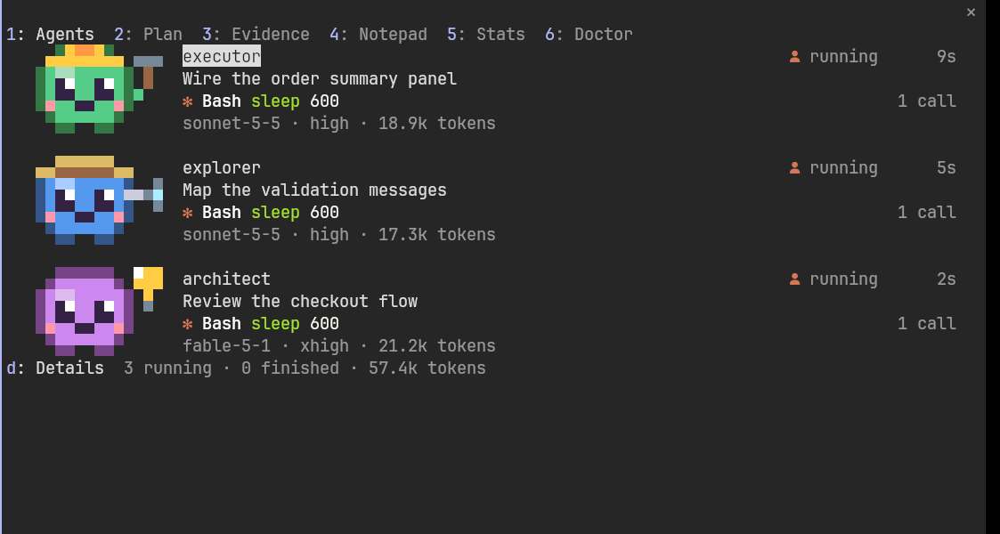

The guard holds a destructive shell command for your review and shows what it would touch.

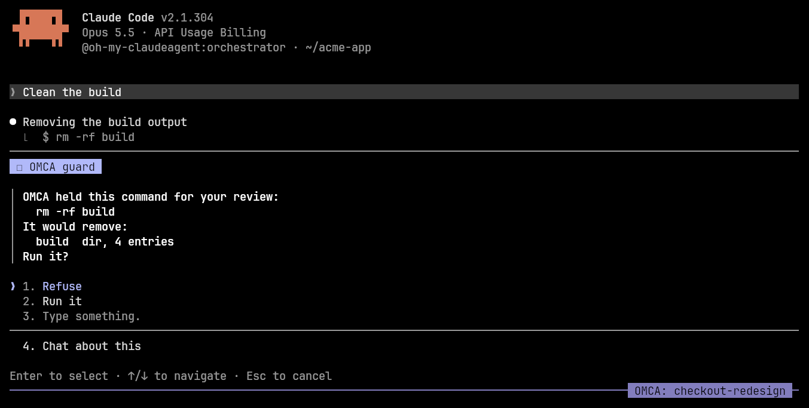

`/omca doctor` checks the client, bun, the server, ast-grep, the options and the settings that
change how OMCA runs. A check with a known fix offers a key that fills the prompt with it, and
the passing checks fold into one line that `o` opens.

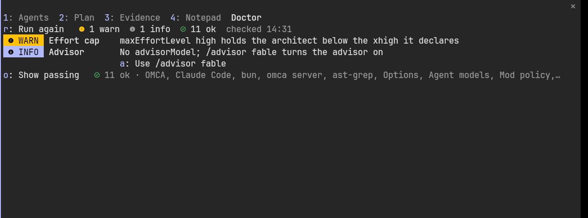

The status line shows the session (model, agent and the plan's next task), the workspace
(context window and git state) and usage (duration, usage limits, and cost for accounts billed
by the token) on rows of their own, and fits itself to the terminal's width. The subagent status
line gives each running agent a row.

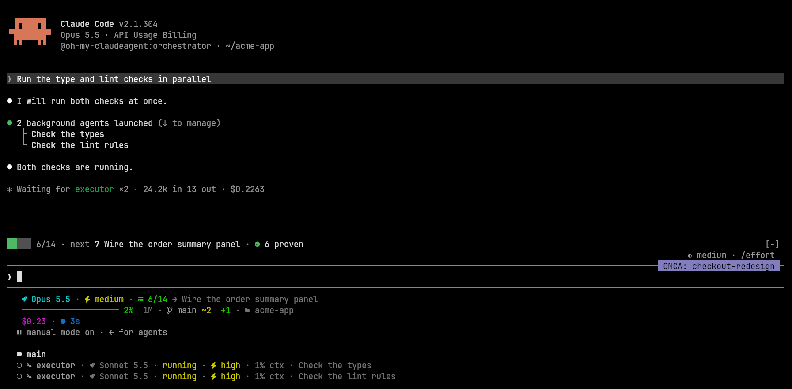

In motion: `/omca plan` opens the board, Down moves the focus, Enter opens the task as a page,
and the number keys switch between the pane's tabs.

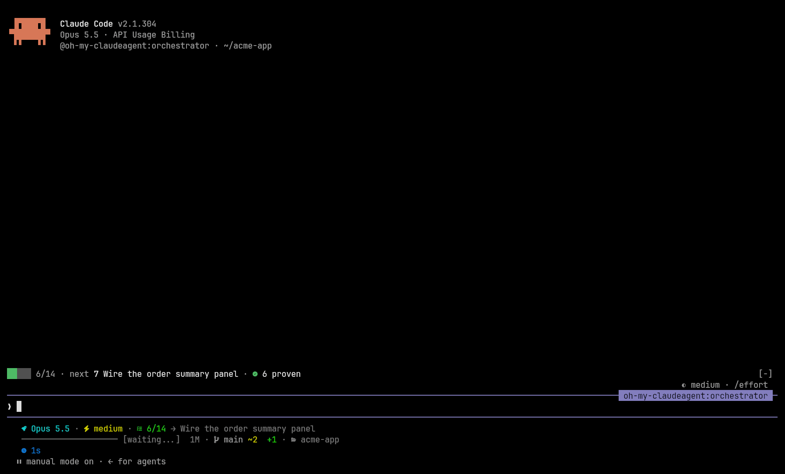

The guard dialog arrives the moment the model asks for a destructive command.

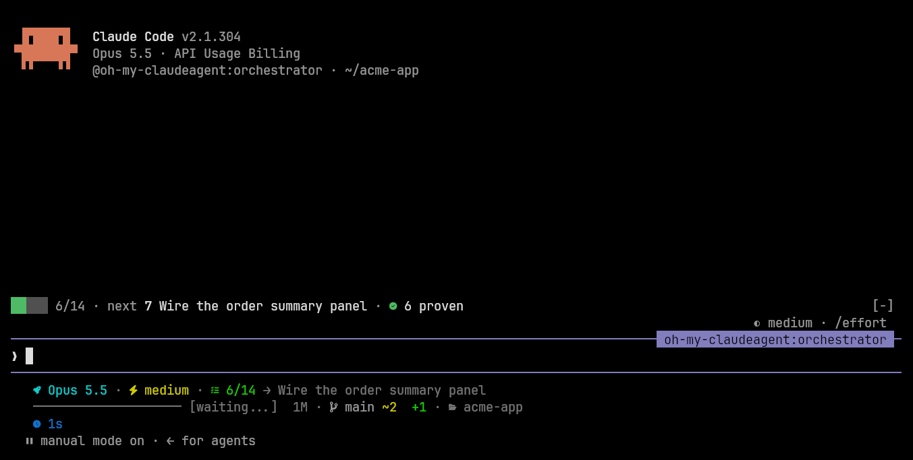

## What OMCA runs, reads and writes

In Claude Code, OMCA runs locally: the `omca` MCP server on bun, a mod inside Claude Code, and, once you set it
up, a status line renderer on bun. None of them makes a network call. Claude Code sends the conversation to Anthropic as it does
without the plugin, and any MCP server you add follows its own policy. [PRIVACY.md](PRIVACY.md)
is the privacy policy.

In OpenCode, the native adapter runs in the connected server. Its terminal panel
uses OpenCode's authenticated client for scoped snapshots; a remote server's
project files stay on that server. OMCA adds no telemetry or external service.

**Settings hooks.** `hooks/hooks.json` registers `SessionStart` (only after `/clear` and
compaction), `UserPromptSubmit`, `UserPromptExpansion`, `SubagentStart`, `PreToolUse` (only
Write and Edit), `PermissionDenied`, `PostToolUse`, `PostToolUseFailure`, `Stop` and
`TaskCompleted`. Each is an `mcp_tool` hook that calls `omca_hook` on the local server. They run
in every session because the gates and the guidance need each turn's events: a plan-write guard
and comment gate on writes, the verification recorder and rule injection after tool calls,
failure advice, guidance and keyword hints on prompts, context for each subagent, an evidence
check on task completion, and the Stop gates. A handler with nothing to do, such as one with no
bound plan, returns nothing.

**What they read.** The prompt text, the inputs and outputs of Read, Write, Edit, Agent, Bash
and PowerShell calls, and the tail of the transcript at Stop. The drift guard runs local `git`.

**The mod.** `hooks/register.ts` handles `tool.check` for Bash and PowerShell (the
destructive-command guard), `tool.call`, `session.start`, `turn.start`, `turn.step`,
`turn.complete`, `agent.spawn`, `prompt.edit`, `prompt.change`, `prompt.autocomplete`, `ui.close`,
`ui.focus`, `ui.scroll`, `command.run` for `/omca`, `ui.render` and `session.compact`. `claude plugin
validate .` lists them with the host calls the mod makes: the file system, the clock, local
processes such as `git`, the settings file (read only), session information, the prompt box and
the UI. It reads these environment variables: `CLAUDE_AFK_TIMEOUT_MS`,
`CLAUDE_CODE_DISABLE_ADVISOR_TOOL`, `CLAUDE_CODE_DISABLE_NONESSENTIAL_TRAFFIC`,
`CLAUDE_CODE_EFFORT_LEVEL`, `CLAUDE_CODE_SUBAGENT_MODEL_FORCE`, `CLAUDE_CONFIG_DIR`,
`DISABLE_GROWTHBOOK`, `DISABLE_TELEMETRY`, `DO_NOT_TRACK`, `HOME`, `HOMEDRIVE`, `HOMEPATH`,
`OMCA_DISABLED_HOOKS`, `OMCA_GLYPHS` and `USERPROFILE`, and writes none.

**What `omca-setup` writes.** Only after it prints a diff and you confirm, it sets `statusLine`
and `subagentStatusLine` in `~/.claude/settings.json`, optionally `env.OMCA_GLYPHS`, and copies
a launcher to `~/.claude/omca/statusline.ts`. The previous file is kept as
`settings.json.omca-bak`. `--uninstall` removes those entries and the launcher. The Doctor page's
`i` fix adds `refreshInterval: 5` the same way, with a backup.

**State.** The plan registry, the evidence ledger, notepads, session status files, mod markers,
delegation metrics and the file-access log live in `.omca/` in the project, never under
`~/.claude/`.

**Switches.** `disableAllHooks` and `allowManagedHooksOnly` turn the settings hooks off,
`allowManagedModsOnly` turns the mod off, and `OMCA_DISABLED_HOOKS` turns off named handlers.
The catastrophic-removal deny has no switch.

**Optional search servers.** OMCA ships no remote MCP server. To add documentation and code
search yourself:

```bash
claude mcp add --scope user --transport http context7 https://mcp.context7.com/mcp
claude mcp add --scope user --transport http grep https://mcp.grep.app
```

The full lists are in the reference: [hooks](docs/references.md#hooks),
[state files](docs/references.md#state-files) and [MCP tools](docs/references.md#mcp-tools).

## Documentation

- [Usage](docs/usage.md): setup, planning, the band and pane, the guard, the doctor, the
  status line and troubleshooting.
- [Reference](docs/references.md): agents, skills, MCP tools, hooks and kill switches,
  configuration, state files, where each feature works, and the comparison with similar
  plugins.
- [File formats](docs/formats.md): plan files, the evidence ledger, notepads and the plan
  registry, with JSON Schemas for the ledger and the registry.
- [Contributing](CONTRIBUTING.md): development setup, adding agents, skills and hooks, and the
  prose and comment policy.
- [Changelog](CHANGELOG.md).

## Acknowledgments

Based on [oh-my-openagent](https://github.com/code-yeongyu/oh-my-openagent) by
[@code-yeongyu](https://github.com/code-yeongyu).

## License

MIT
